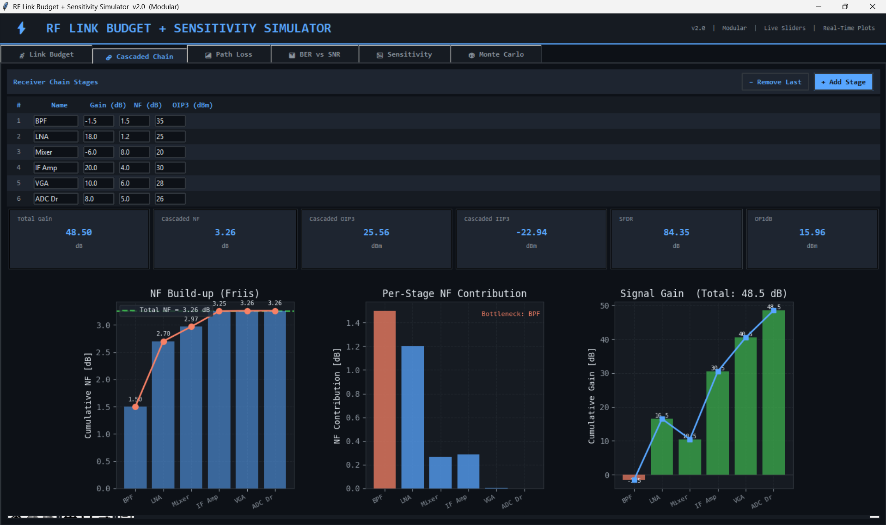
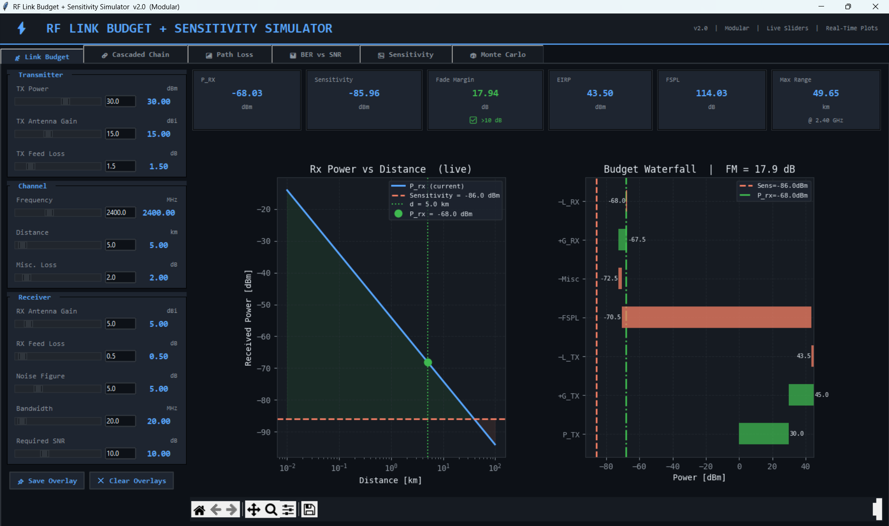
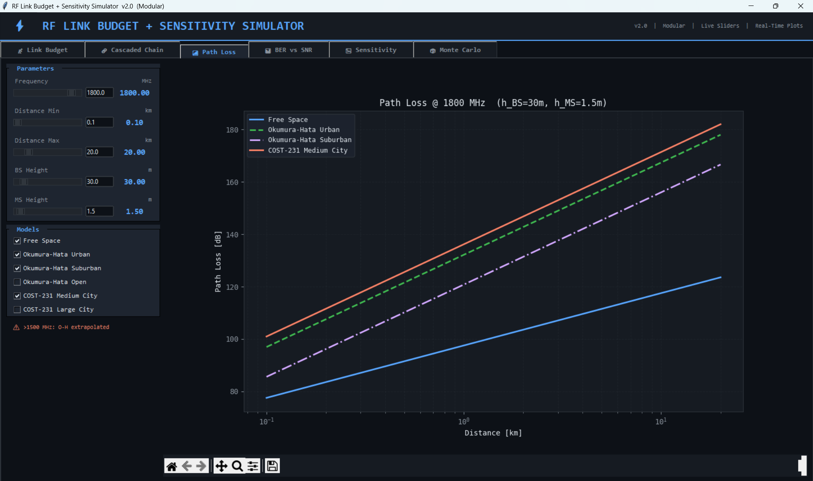
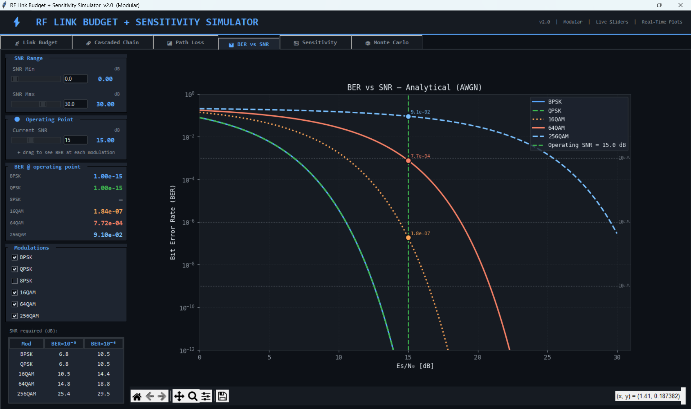
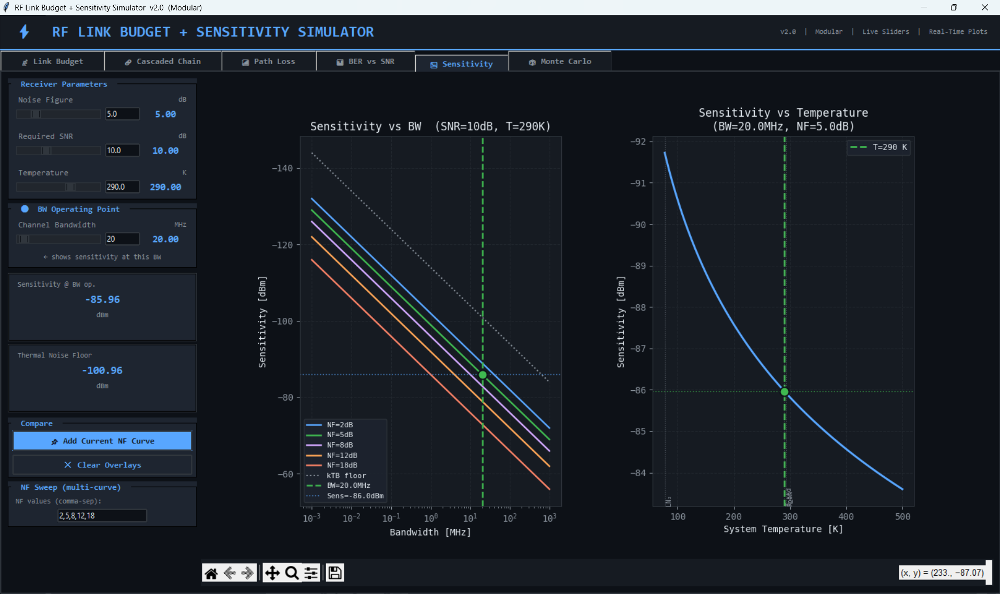
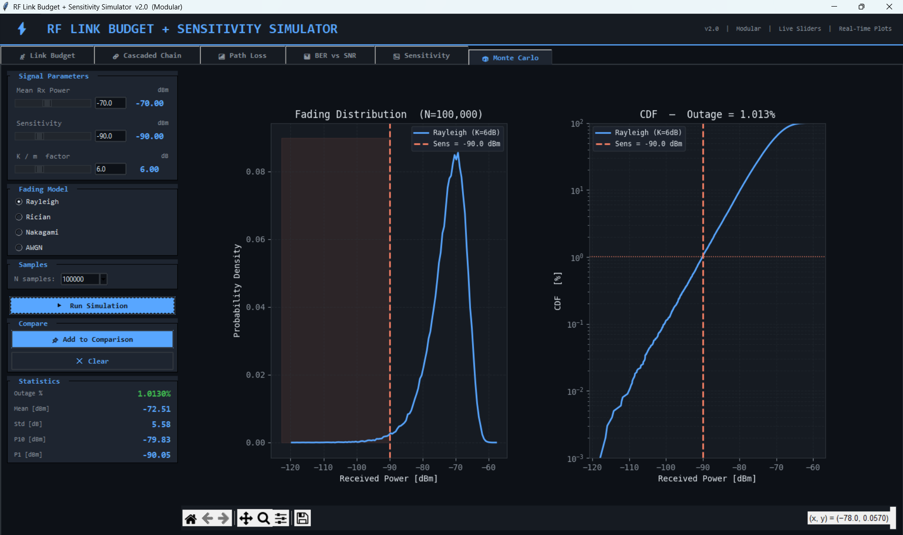

# RF Link Budget and Sensitivity Simulator

A desktop tool for RF receiver and link analysis. Move a slider and the link budget, cascaded noise figure, linearity, path loss, BER and fading statistics update live.

The calculation code in `core/` has no GUI dependency, so every formula can be tested on its own. The Tkinter and Matplotlib interface sits on top of it.



## What it does

| Tab | What you get |
|---|---|
| **Link Budget** | Friis free-space link: received power, sensitivity, fade margin, EIRP, FSPL, maximum range. Rx power versus distance and a budget waterfall. |
| **Cascaded Chain** | Editable receiver chain (gain, NF, OIP3 per stage). Cascaded NF by Friis, cascaded OIP3 and IIP3, SFDR, OP1dB, and per-stage NF contribution with the bottleneck highlighted. |
| **Path Loss** | Free space, Okumura-Hata (urban, suburban, open) and COST-231 Hata (medium and large city) against distance. |
| **BER vs SNR** | Analytical AWGN BER for BPSK, QPSK, 8PSK, 16QAM, 64QAM and 256QAM, with BER at an operating SNR and the SNR needed for 1e-3 and 1e-6. |
| **Sensitivity** | Sensitivity against bandwidth for several noise figures, and against temperature, with the kTB floor. |
| **Monte Carlo** | Rayleigh, Rician, Nakagami and AWGN fading. Outage probability, mean, spread, P10 and P1 of received power. |

## Quick start

Python 3.10 or newer. Tkinter comes with the python.org installer for Windows and macOS. On Linux, install `python3-tk` first.

```bash
python -m pip install -r rf_simulator/requirements.txt
cd rf_simulator
python main.py
```

`python setup_and_run.py` installs missing packages and launches the app in one step. Add `--check` to only check the dependencies, or `--test` to run the tests.

Run the tests from the repository root:

```bash
python -m pip install -r rf_simulator/requirements-dev.txt
python -m pytest rf_simulator/tests -q
```

## Screenshots

| Link budget | Path loss |
|---|---|
|  |  |

| BER vs SNR | Sensitivity |
|---|---|
|  |  |



## Equations used

Free-space path loss:

```
FSPL(dB) = 20 log10(d) + 20 log10(f) + 20 log10(4*pi/c)
```

Received power and thermal noise:

```
P_rx = P_tx + G_tx - L_tx - FSPL - L_misc + G_rx - L_rx
N    = -174 dBm/Hz + 10 log10(B) + NF
Sensitivity = kTB + NF + SNR_required
Fade margin = P_rx - Sensitivity
```

Cascaded noise figure (Friis):

```
F_total = F1 + (F2 - 1)/G1 + (F3 - 1)/(G1 G2) + ...
```

Cascaded OIP3 (inverse power sum, each stage referred to the output):

```
1/OIP3_sys = sum over i of  1 / (OIP3_i * G_after_i)
```

`G_after_i` is the linear gain of all stages after stage i. IIP3 = OIP3 minus total gain. SFDR = (2/3)(OIP3 - noise floor), and OP1dB is estimated as OIP3 minus 9.6 dB.

## Default receiver chain

Defined in `rf_simulator/config/defaults.json`:

| Stage | Gain (dB) | NF (dB) | OIP3 (dBm) |
|---|---|---|---|
| BPF | -1.5 | 1.5 | 35 |
| LNA | 18 | 1.2 | 25 |
| Mixer | -6 | 8 | 20 |
| IF Amp | 20 | 4 | 30 |
| VGA | 10 | 6 | 28 |
| ADC Driver | 8 | 5 | 26 |

Result: total gain 48.50 dB, cascaded NF 3.26 dB, cascaded OIP3 25.56 dBm, IIP3 -22.94 dBm. The bandpass filter is flagged as the NF bottleneck because it sits first and its loss adds directly to the noise figure.

## Verification

The core functions are checked against hand calculations:

- **Link budget:** at 2.4 GHz and 5 km, FSPL is 114.03 dB, EIRP is 43.5 dBm and received power is -68.03 dBm, matching the hand sum.
- **Sensitivity:** 20 MHz, NF 5 dB, SNR 10 dB gives -85.96 dBm.
- **Cascaded OIP3:** a 10 dB / 20 dBm stage followed by a 10 dB / 30 dBm stage gives 26.99 dBm (`1/OIP3 = 1/1000 + 1/(100*10)` per mW). This is a unit test.
- **Rayleigh outage:** for a mean power of -70 dBm and sensitivity of -90 dBm, theory gives 1 - exp(-0.01) = 0.995%. The Monte Carlo run with 100,000 samples gives about 1.01%.

The 32 unit tests cover the Friis, noise, linearity, path loss and modulation modules without opening a window.

## Project layout

```
rf_simulator/
  main.py              entry point
  setup_and_run.py     dependency check and launcher
  config/defaults.json default parameters for every tab
  core/                calculation code, no GUI imports
    friis.py  noise.py  linearity.py  path_loss.py  modulation.py  monte_carlo.py
  gui/                 Tkinter and Matplotlib interface
    app.py  theme.py  widgets.py  tabs/
  tests/test_core.py   unit tests
```

## Limitations

- Okumura-Hata is defined for 150 to 1500 MHz. Above that the tool extrapolates and shows a warning.
- BER curves are analytical AWGN results with no coding, and they do not model fading.
- Cascaded OIP3 uses the inverse power sum, which assumes the intermodulation products of the stages add in power. The coherent worst case is lower.
- SFDR uses the thermal floor for a 20 MHz bandwidth without adding the receiver noise figure.

## Changelog

- Fixed the cascaded OIP3 formula to `1/OIP3 = sum(1/(OIP3_i * G_after_i))` and added a two-stage hand-calculation test.

